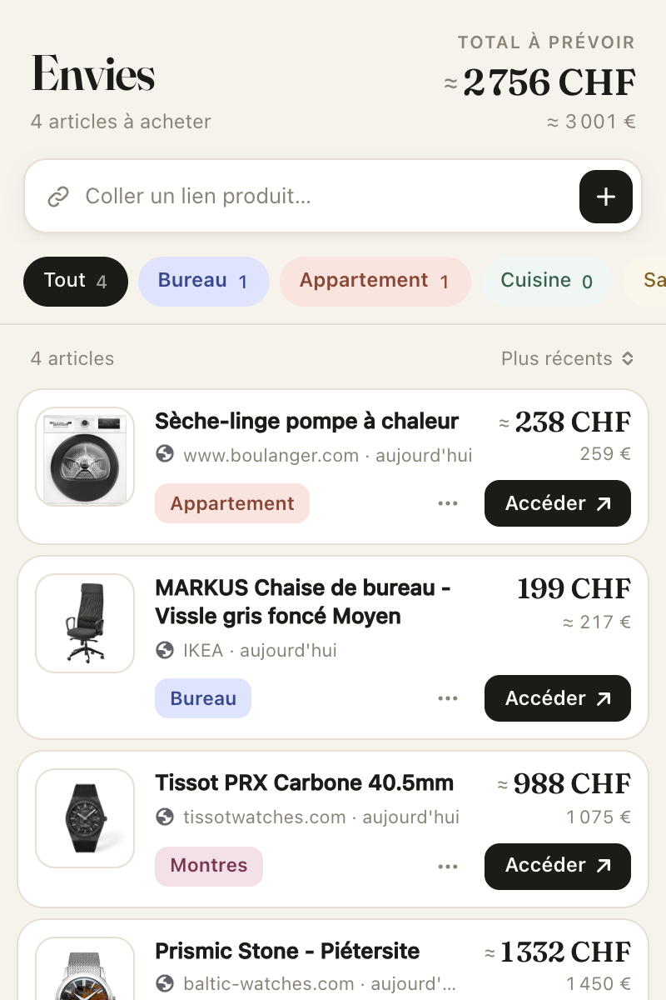
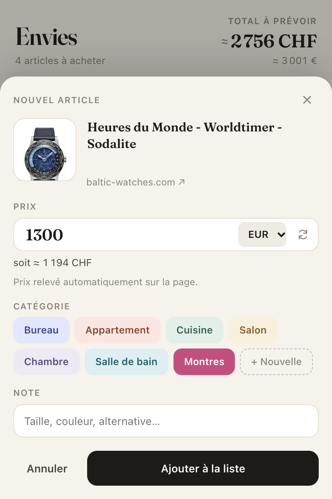

<h1 align="center">Envies</h1>

Ta liste d'achats dans Chrome : tu colles un lien, le nom, la photo et le prix arrivent tout seuls.

  
  &nbsp;
  

## Ce que ça fait

- **Un lien, une fiche complète** : nom, photo et prix relevés sur la page (Amazon, IKEA, Boulanger, boutiques de montres et la plupart des sites marchands).
- **Des catégories en couleur** : Bureau, Appartement, Cuisine, Salon, Chambre, Salle de bain… et celles que tu crées.
- **Les prix en francs suisses**, avec l'équivalent en euros juste en dessous (taux du jour de la Banque centrale européenne). Un clic sur le total passe tout en euros.
- **Le bouton « Accéder »** rouvre la fiche du produit.
- **Le suivi des prix** : « Relire le prix » met à jour et affiche la baisse ou la hausse depuis l'ajout.
- **Plusieurs liens d'un coup**, le clic droit « Ajouter à mes envies », « Marquer comme acheté »…

## Installer (2 minutes)

Envies n'est pas sur le Chrome Web Store : on l'installe à la main, une seule fois.

1. En haut de cette page : bouton vert **Code** → **Download ZIP**, puis dézippe le fichier. Range le dossier `envies-main` à un endroit où il restera (Documents, par exemple) : Chrome le relit à chaque démarrage.
2. Dans Chrome, ouvre `chrome://extensions`.
3. Active le **Mode développeur** (interrupteur en haut à droite).
4. Clique sur **Charger l'extension non empaquetée** et choisis le dossier `envies-main` (celui qui contient `manifest.json`).
5. Épingle l'icône : pièce de puzzle à droite de la barre d'adresse, puis la punaise à côté d'**Envies**.

Pour l'ouvrir au clavier : <kbd>⌥</kbd> <kbd>⇧</kbd> <kbd>E</kbd> sur Mac, <kbd>Alt</kbd> <kbd>Maj</kbd> <kbd>E</kbd> sur Windows.

Ça devrait marcher pareil dans Edge, Brave ou Arc, depuis leur page d'extensions (pas testé).

> **Chrome prévient qu'Envies peut « lire et modifier vos données sur tous les sites ».**
> C'est ce qui lui permet d'ouvrir la page d'un produit pour y lire le prix. Elle ne le fait que pour les liens que tu ajoutes, et elle n'envoie ta liste nulle part.

## L'utiliser

| Pour… | Fais… |
|---|---|
| Ajouter la page que tu regardes | Ouvre Envies → **Ajouter la page actuelle** |
| Ajouter un lien copié | Ouvre Envies et fais <kbd>⌘</kbd> <kbd>V</kbd> (ou <kbd>Ctrl</kbd> <kbd>V</kbd>), ou colle-le dans le champ |
| Ajouter plusieurs liens | Colle-les d'un coup, un par ligne : ils vont dans la catégorie affichée et leurs prix arrivent en quelques secondes |
| Ajouter sans ouvrir Envies | Clic droit sur une page ou un lien → **Ajouter à mes envies** |
| Ranger un article | Clic sur son étiquette de catégorie |
| Créer, renommer ou recolorer une catégorie | **+ Catégorie**, ou **Gérer** au bout de la rangée |
| Mettre un prix à jour | **⋯** → **Relire le prix** |
| Noter un achat | **⋯** → **Marquer comme acheté** (l'article sort du total) |
| Voir les montants en euros | Clic sur le total, en haut à droite |

Quand Envies lit plusieurs liens d'un coup, des onglets s'ouvrent et se referment seuls en arrière-plan : c'est normal, elle y relève les prix.

## Bon à savoir

- **Prix introuvable ?** Certains sites bloquent la lecture automatique. La fiche te le dit : tape le prix, il est gardé.
- **Lien mort ?** Si la page n'existe plus (erreur 404, renvoi vers l'accueil du site), Envies le note sur l'article.
- **Ta liste reste chez toi** : elle est enregistrée dans ton Chrome, pas en ligne. Envies ne contacte que les pages produits que tu ajoutes et, deux fois par jour au plus, [frankfurter.dev](https://frankfurter.dev) pour le taux de change.
- **Pas de synchronisation** entre ordinateurs pour l'instant, et supprimer l'extension efface la liste.

## Mettre à jour

Retélécharge le ZIP, remplace les fichiers **dans le même dossier**, puis clique sur ↻ sur la carte d'Envies dans `chrome://extensions`. Ta liste est conservée. Ne clique surtout pas sur « Supprimer » : ça l'effacerait.

---

Pour les curieux : comment c'est fait

Extension Chrome (Manifest V3) en JavaScript, sans aucune dépendance.

| Fichier | Rôle |
|---|---|
| `manifest.json` | déclaration de l'extension |
| `extract.js` | lecture du titre, du prix, de la devise et de l'image d'une page : données produit structurées (JSON-LD), balises meta, microdonnées, sélecteurs connus (Amazon), puis le prix le plus visible de la page |
| `shared.js` | stockage, catégories par défaut, nettoyage des liens, taux de change |
| `background.js` | clic droit, lecture des prix en arrière-plan, ajout de plusieurs liens |
| `popup.html`, `popup.css`, `popup.js` | l'interface |
| `icons/` | icônes |

Un fichier `import.json` optionnel posé à la racine (`{"id", "category", "items": [{"url", …}]}`) est importé une fois, au démarrage suivant de l'extension.

